  

  

  <a href="https://orcid.org/0000-0002-2524-6416">ORCID</a> ·
  <a href="https://github.com/dzutrinh/EMUFAMI">EMUFAMI</a> ·
  <a href="https://github.com/dzutrinh/TMGDL">TMGDL</a> ·
  <a href="https://github.com/dzutrinh/2048">2048</a> ·
  <a href="https://github.com/dzutrinh/Color-Reduction">Color-Reduction</a> ·
  <a href="https://github.com/dzutrinh/Sort-CLI">Sort-CLI</a>

