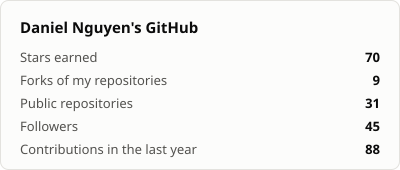
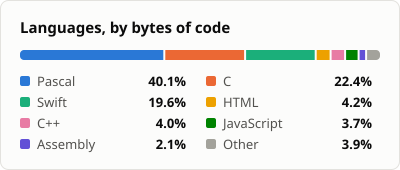

<ul>
  <li>🔬 <strong>Data Mining Researcher</strong>: high-utility itemset and pattern mining (<a href="https://orcid.org/0000-0002-2524-6416">ORCID</a>)</li>
  <li>🕹️ <strong>Retro Games</strong> | 🖥️ <strong>Text-Mode and Terminal UIs</strong> | 💾 <strong>DOS</strong></li>
  <li>🧰 <strong>Pascal | C | Swift | x86 Assembly</strong></li>
  <li>🎨 Color quantization, dithering, ray casting, and a <a href="https://github.com/dzutrinh/EMUFAMI">NES emulator in Pascal</a></li>
  <li>🍏 Small <strong>macOS utilities</strong> in Swift</li>
</ul>

  
  

